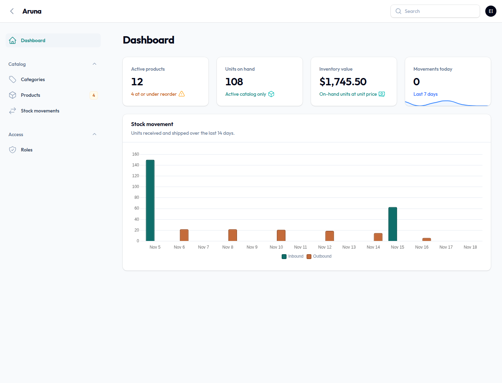
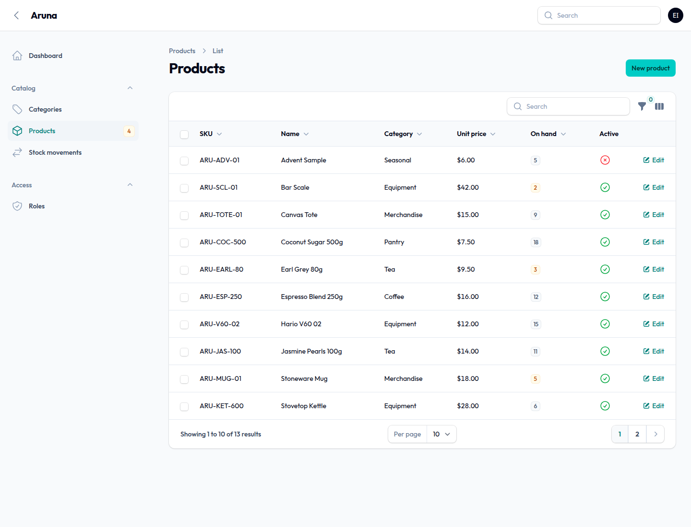
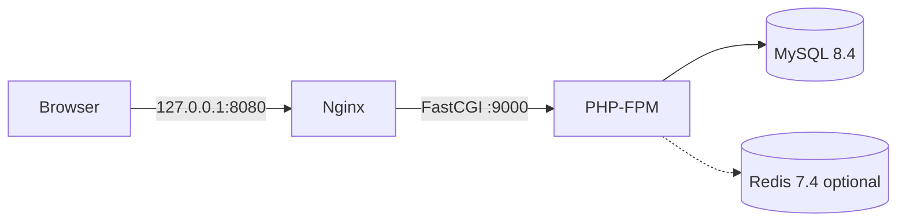

# Aruna Inventory

A production-minded Laravel and Filament starter: an admin panel for a small catalog, with roles, a stock ledger, Docker, and CI for both GitHub Actions and GitLab.

[](https://github.com/EnriqueMuhammad/laravel-filament-starter/actions/workflows/ci.yml)
[](https://laravel.com)
[](https://filamentphp.com)
[](https://www.php.net)
[](LICENSE)

Author: **Enrique Muhammad**.

## Screenshots





## Stack

- PHP 8.4 in Docker, PHP 8.3+ on the host
- Laravel 13
- Filament 5 admin panel
- Filament Shield and [spatie/laravel-permission](https://github.com/spatie/laravel-permission)
- MySQL 8.4
- Redis 7.4, optional
- Nginx and PHP-FPM
- Pest, Laravel Pint, Larastan
- GitHub Actions and GitLab CI

## Architecture



Nginx only publishes `127.0.0.1:8080`. MySQL publishes `127.0.0.1:3307` (container port 3306) so a MySQL already running on the host does not collide, and host tools can still connect. Redis is not published and stays on the Compose network. Start it with `docker compose --profile redis up -d`, then point `CACHE_STORE`, `SESSION_DRIVER`, or `QUEUE_CONNECTION` at `redis`.

The app boots without Redis. Cache, sessions, and queues use the database by default.

## Quick start

Requirements: Docker with Compose v2, and GNU Make.

```bash
cp .env.example .env
docker compose up -d
make setup
```

`make setup` is safe to run after the copy as well. It builds the containers, installs Composer dependencies, generates `APP_KEY`, migrates, seeds, links storage, and publishes Filament assets.

Open [http://localhost:8080/admin](http://localhost:8080/admin).

| Command | What it does |
| --- | --- |
| `make up` | Build and start the stack |
| `make down` | Stop containers, keep the database volume |
| `make logs` | Follow logs |
| `make shell` | Shell in the PHP container |
| `make test` | Pest inside the container |
| `make pint` | Pint check |
| `make stan` | Larastan |
| `make fresh` | Drop, migrate, and seed again |

`UID` and `GID` in `.env` map the PHP user onto your host user so the bind mount stays writable. The defaults are `1000:1000`.

## Demo credentials

These accounts are seeded for a local demo. Do not reuse the password anywhere else, and do not run the demo seeder on a server you share.

| Role | Email | Password | Can do |
| --- | --- | --- | --- |
| Super admin | `admin@example.com` | `password` | Everything, including roles |
| Inventory manager | `manager@example.com` | `password` | Create and edit the catalog and ledger |
| Auditor | `viewer@example.com` | `password` | Read the catalog and ledger |

The super admin is Enrique Muhammad. Filament Shield bypasses policies for the `super_admin` role. Managers do not see role management.

## What the demo shows

- **Categories, products, and stock movements** as Filament resources, with search, filters, and a low-stock badge
- **On-hand quantity** recalculated from the ledger. Inbound and outbound use a positive quantity. Adjustments may be negative. A movement that would take stock below zero is rejected
- **Dashboard** with active products, units, inventory value, today's movements, and a 14-day inbound/outbound chart
- **Roles** for super admin, manager, and auditor

A few products are intentionally under their reorder level so the amber badges and the navigation count are visible.

## Tests and static analysis

CI runs Pest against a MySQL 8.4 service. Locally, create a database the defaults can reach, or export the same variables CI uses:

```bash
# defaults expected by phpunit.xml when the environment does not override them
# database: inventory_testing
# user: inventory
# password: inventory
# host: 127.0.0.1

vendor/bin/pint --test
vendor/bin/phpstan analyse --memory-limit=1G
php artisan test
```

## Deployment notes

`compose.yaml` is the local stack: bind-mounted source, dev PHP image, published database port.

`compose.prod.yaml` builds two images from the same Dockerfile:

- `production` — PHP-FPM, Composer dependencies without dev packages, Filament assets published, process user `www-data`
- `web` — Nginx with the same `public/` directory

```bash
cp .env.example .env
# Set APP_ENV=production, APP_DEBUG=false, APP_URL, and real database passwords.
php -r "echo 'base64:'.base64_encode(random_bytes(32)), PHP_EOL;"
# Put that value in APP_KEY.

docker compose -f compose.prod.yaml up -d --build
docker compose -f compose.prod.yaml exec app php artisan migrate --force
```

Skip `db:seed` on a real server. The seeder creates the demo password above. If you need the roles without the sample catalog, run `RoleAndPermissionSeeder` on its own and create a real administrator.

Before you expose the panel:

- Terminate TLS at the load balancer or in Nginx, and set `APP_URL` to the https origin
- Set `TRUSTED_PROXIES` when the app sits behind a proxy
- Keep MySQL and Redis off the public internet
- Run `php artisan config:cache`, `route:cache`, and `view:cache` after the environment is final
- Put a queue worker beside the app if you switch `QUEUE_CONNECTION` to `database` or `redis` and start sending jobs

GitHub Actions (`.github/workflows/ci.yml`) runs Pint, Larastan, Pest on MySQL, and `docker build --target production`. `.gitlab-ci.yml` is the same pipeline for GitLab.

## License

MIT. Copyright (c) 2026 Enrique Muhammad.
